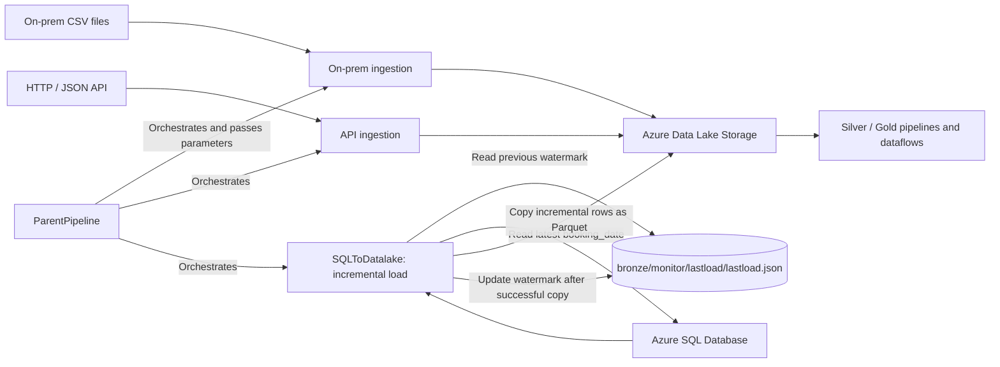
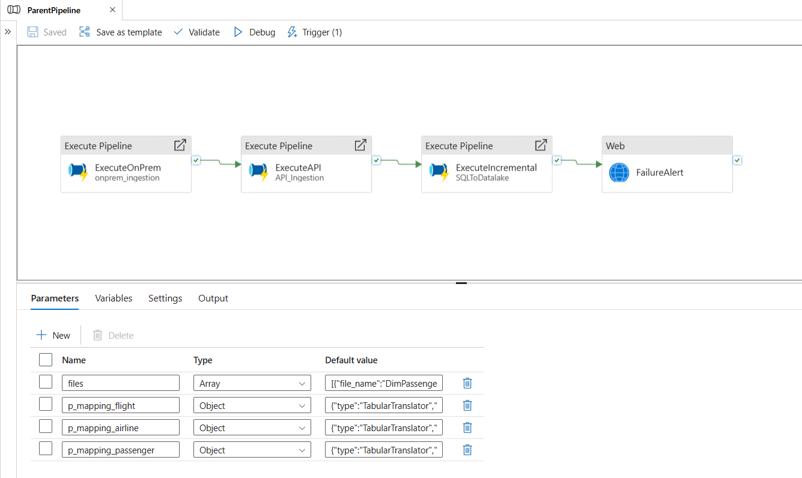
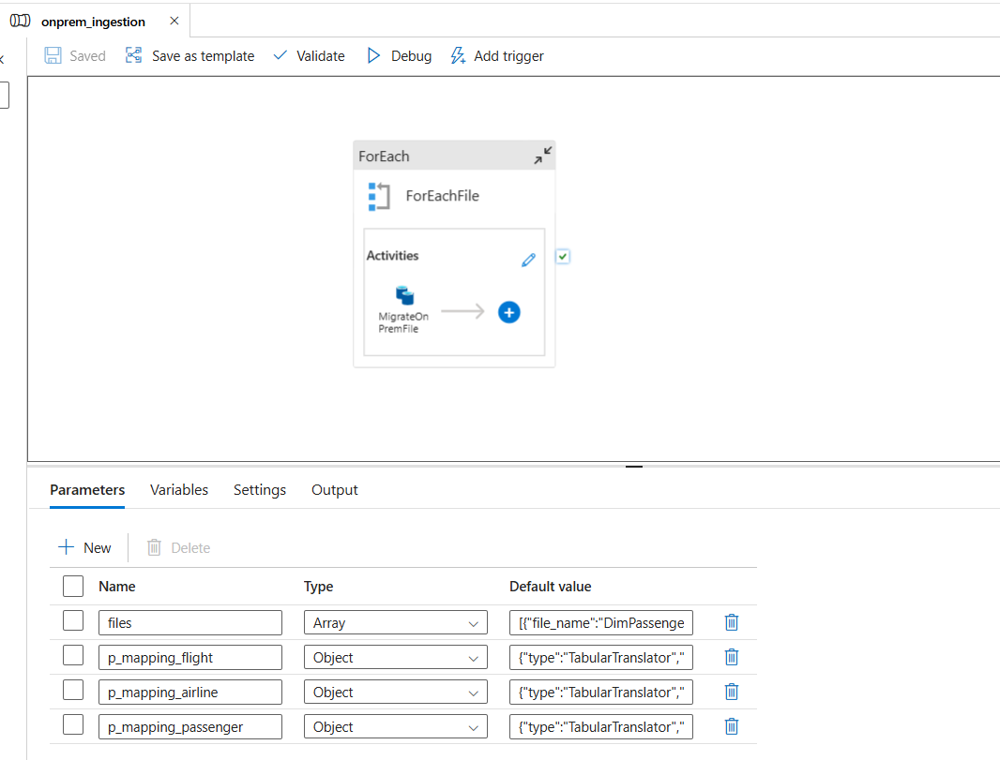
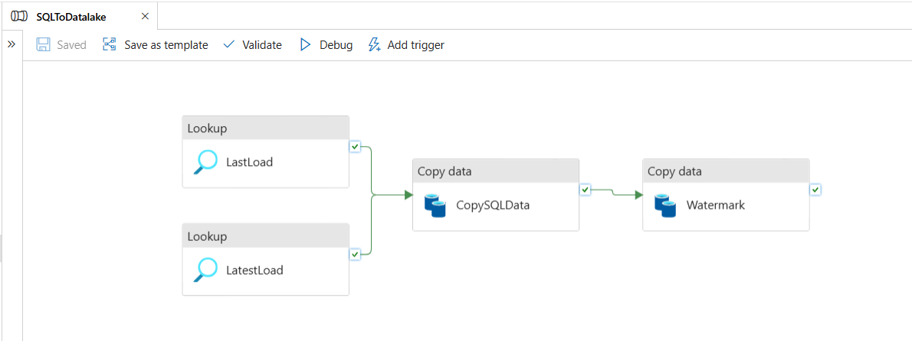
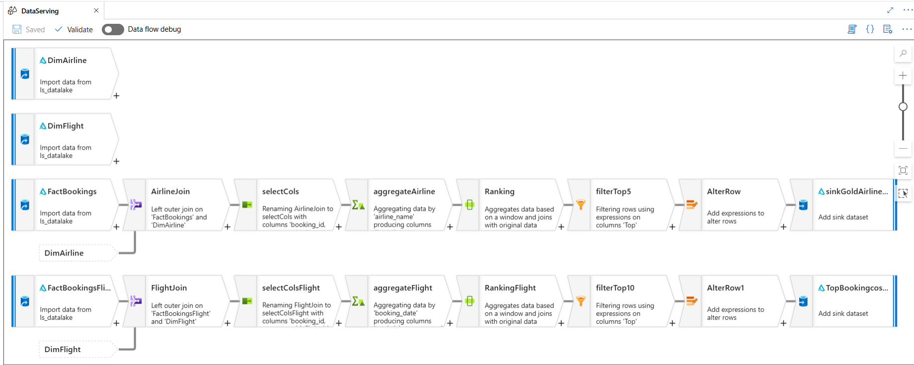
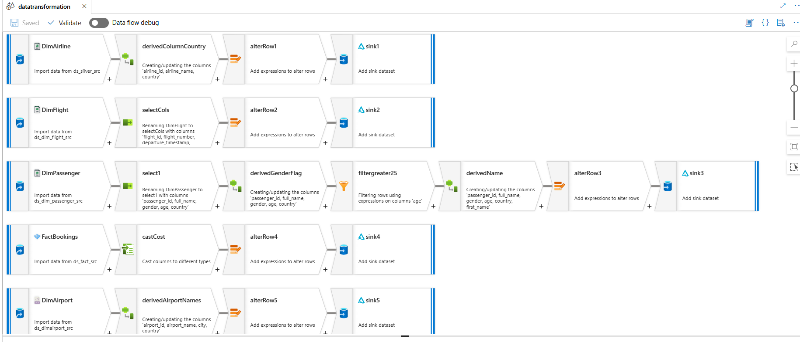
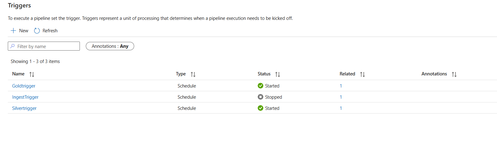
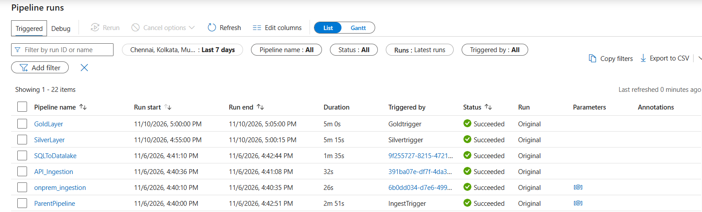
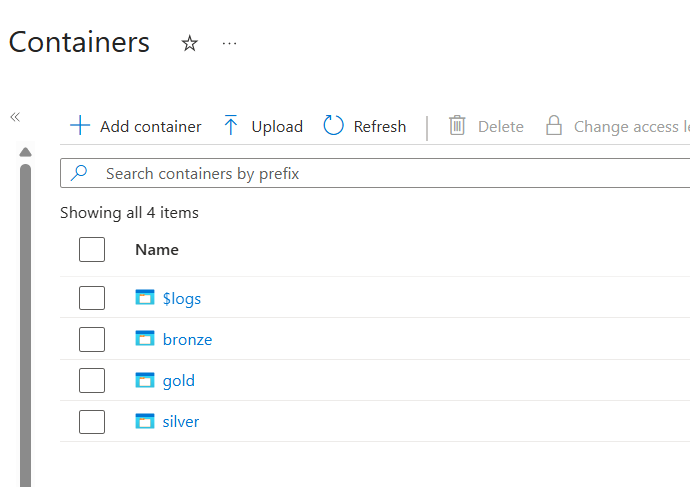

# Azure Data Integration with Azure Data Factory

[](https://azure.microsoft.com/products/data-factory/)
[](https://azure.microsoft.com/products/storage/data-lake-storage/)
[](https://azure.microsoft.com/products/azure-sql/database/)

An Azure Data Factory portfolio project for ingesting on-premises files, HTTP/JSON data, and Azure SQL records into Azure Data Lake Storage. It demonstrates pipeline orchestration, incremental loading with a stored watermark, and downstream transformation and serving flows.

## Project highlights

- **Orchestration:** `ParentPipeline` invokes the on-premises, API, and incremental SQL pipelines and passes file and mapping parameters.
- **File ingestion:** `onprem_ingestion` loops over configured CSV files and copies them from a file-server source to the lake.
- **API ingestion:** `API_Ingestion` reads airport JSON over HTTP and writes it to the lake.
- **Incremental SQL load:** `SQLToDatalake` reads the previous watermark from `bronze/monitor/lastload/lastload.json`, looks up the latest `booking_date`, copies the corresponding `FactBookings` range to Parquet, then updates the watermark after a successful copy.
- **Transform and serve:** Silver/Gold pipeline and mapping dataflow assets are included.

## Architecture



The parent pipeline orchestrates child pipelines; it passes parameters to on-premises ingestion, while that child pipeline reads the source files. The watermark dataset is configured in Azure Data Lake Storage Gen2 in the `bronze` filesystem/container at `monitor/lastload/lastload.json`.

## Repository layout

```text
.
├── dataflow/             # Transformation and serving dataflows
├── dataset/              # Source, sink, lookup, and parameterized datasets
├── factory/              # Factory configuration
├── integrationRuntime/   # Integration runtime definition
├── linkedService/        # Source and destination connections
├── pipeline/             # Orchestration, ingestion, and layer pipelines
├── trigger/              # Schedule trigger definitions
├── docs/images/          # Project screenshots
└── publish_config.json   # ADF publish branch settings
```

### Key pipelines and dataflows

| Asset | Role |
| --- | --- |
| `ParentPipeline` | Orchestrates the child pipelines and passes parameters. |
| `onprem_ingestion` | Copies parameterized CSV files from a file-server source to Data Lake Storage. |
| `API_Ingestion` | Loads airport JSON from an HTTP source. |
| `SQLToDatalake` | Performs watermark-based incremental extraction of `dbo.FactBookings` and writes Parquet output. |
| `SilverLayer`, `GoldLayer` | Define downstream layer-processing pipelines. |
| `datatransformation`, `DataServing` | Define mapping dataflows for transformation and serving. |
| `IngestTrigger` | Defines a schedule trigger for the parent pipeline. Check its current state and schedule in ADF. |

## Tools and services

- Azure Data Factory
- Azure Data Lake Storage Gen2
- Azure SQL Database
- ADF Copy and Lookup activities, Web activity, Mapping Data Flows, and schedule triggers
- JSON-based ADF resource definitions

## Prerequisites

- An Azure subscription and Azure Data Factory instance
- Azure Data Lake Storage Gen2 account with the required filesystems and folders
- Azure SQL Database containing the source objects expected by the pipelines, including `dbo.FactBookings`
- Reachable HTTP/JSON source
- Self-hosted integration runtime with access to the on-premises file source, if applicable
- Required identity, network, storage, database, and Key Vault permissions

## Deployment and configuration

1. Clone the repository and review the ADF JSON assets.
2. Connect ADF Studio to this Git repository and configure the collaboration branch and root folder. `publish_config.json` specifies `adf_publish` as the publish branch; align this with your ADF Git setup.
3. Configure linked services for your environment. Prefer managed identity or Key Vault references; do not commit secrets or credential payloads.
4. Configure and test a self-hosted integration runtime if the file source is on-premises.
5. Verify dataset paths, schemas, SQL objects, mappings, pipeline parameters, and the watermark location.
6. Validate and test each pipeline with non-production data. Check retries, failure paths, and activity logging.
7. Review trigger schedules, time zones, start/end dates, and states before enabling automated runs.
8. Publish from ADF Studio and monitor runs, row counts, watermark values, and output files.

This repository contains ADF resource definitions and publish configuration; it does not include a complete infrastructure-as-code deployment template or CI/CD workflow.

## Security and operational notes

- Replace environment-specific endpoints and credentials before deployment. If a secret has been committed, rotate it; deleting it from the latest file does not remove it from repository history.
- Prefer managed identity and Key Vault references, and grant only the permissions required by each linked service.
- Review `secureInput` and `secureOutput` settings to avoid exposing sensitive activity data in monitoring output.
- Test watermark behavior for initial runs, empty ranges, late-arriving rows, and failures to prevent missed or duplicated data.
- Review trigger settings and alert activity dependency conditions. In the exported parent pipeline, `FailureAlert` is configured after successful completion of the incremental load, so verify that its dependency matches your intended alert behavior.

## Screenshots

Screenshots are stored in [`docs/images/`](docs/images/) and show the pipeline assets and Azure Data Factory environment.

### Parent pipeline orchestration


### On-premises file ingestion


### Incremental SQL load and watermark


### DataServing dataflow


### Data transformation dataflow


### ADF triggers


### Pipeline run monitoring


### Data Lake containers

