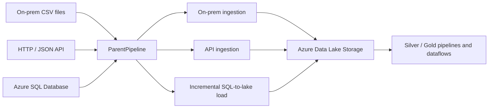

# Azure Data Integration with Azure Data Factory

[](https://azure.microsoft.com/products/data-factory/)
[](https://azure.microsoft.com/)
[](https://www.json.org/)

An Azure Data Factory portfolio project demonstrating how to orchestrate ingestion from on-premises files, a REST/HTTP source, and Azure SQL Database into Azure Data Lake Storage. The repository contains exported ADF artifacts for ingestion, incremental loading, transformation, and serving workflows.

> **Portfolio summary:** This project brings together parameterized file ingestion, API-based ingestion, SQL watermarking, Parquet output, and reusable ADF pipeline orchestration. It is an infrastructure/configuration project: the repository contains ADF JSON assets rather than an application runtime or local test suite.

## At a glance

- **Orchestration:** A parent pipeline sequences on-premises ingestion, API ingestion, and incremental SQL extraction.
- **File ingestion:** A `ForEach` activity processes configured files, including `DimPassenger.csv`, `DimAirline.csv`, and `DimFlight.csv`.
- **API ingestion:** An HTTP/JSON source loads airport data into a lake sink.
- **Incremental processing:** `SQLToDatalake` reads a watermark and the latest `booking_date`, copies the matching `FactBookings` range to Parquet, then updates the watermark.
- **Transform and serve:** Dataflow definitions and Silver/Gold pipeline assets are included.
- **Scheduling:** A daily schedule trigger references the parent pipeline.

## Architecture



The parent pipeline currently runs the on-premises ingestion, API ingestion, and SQL-to-lake pipeline sequentially. Review the pipeline dependency settings before relying on notification behavior: the activity named `FailureAlert` in the exported definition is configured after a successful incremental-load activity.

## Repository structure

```text
.
├── dataflow/             # Data transformation and serving dataflows
├── dataset/              # Source, sink, lookup, and parameterized datasets
├── factory/              # Factory configuration
├── integrationRuntime/   # Integration runtime definition
├── linkedService/        # Azure SQL, Data Lake, on-premises, and GitHub connections
├── pipeline/             # Parent and ingestion/layer pipelines
├── trigger/              # Schedule trigger
├── publish_config.json   # ADF publish branch settings
└── README.md
```

### Main pipeline assets

| Asset | Purpose |
| --- | --- |
| `ParentPipeline` | Orchestrates the child pipelines and passes file/mapping parameters. |
| `onprem_ingestion` | Copies parameterized CSV files from a file-server source to Data Lake Storage. |
| `API_Ingestion` | Reads airport JSON over HTTP and writes it to the lake. |
| `SQLToDatalake` | Uses a load watermark to extract new `FactBookings` rows and writes Parquet output. |
| `SilverLayer`, `GoldLayer` | Define downstream layer-processing pipelines. |
| `datatransformation`, `DataServing` | Define mapping dataflows for transformation and serving. |
| `IngestTrigger` | Schedules the parent pipeline; review its recurrence and configured end time for your environment. |

## Technology

- Azure Data Factory
- Azure Data Lake Storage Gen2
- Azure SQL Database
- ADF Copy activities, Lookup activities, Web activity, Mapping Data Flows, and schedule triggers
- JSON-based ADF authoring artifacts

## Prerequisites

Before deployment, prepare:

1. An Azure subscription and Azure Data Factory instance.
2. An Azure Data Lake Storage Gen2 account and the required containers/directories.
3. An Azure SQL Database with the source table and watermark data expected by the pipelines (including `dbo.FactBookings`).
4. A reachable HTTP source and the expected JSON schema.
5. A self-hosted integration runtime with network access to the on-premises file source, if using that source.
6. Appropriate identity, storage, database, network, and Key Vault permissions.

## Deploy and configure

1. **Review the assets.** Clone the repository and inspect the JSON definitions before connecting them to an Azure environment.
2. **Connect ADF to source control.** In ADF Studio, configure the Git repository, collaboration branch, and root folder for this project. The repository's `publish_config.json` identifies `adf_publish` as its publish branch; ensure your ADF Git configuration matches your intended workflow.
3. **Configure linked services.** Replace environment-specific endpoints and authentication with your own values. Prefer managed identity or Azure Key Vault-backed secrets; do not commit passwords, tokens, or credential payloads.
4. **Configure the integration runtime.** Set up and register a self-hosted integration runtime if the file source is on-premises, then verify connectivity from the runtime host.
5. **Validate datasets and parameters.** Check file paths, names, schemas, SQL objects, lake locations, mappings, and the watermark location. Ensure source and destination schemas agree.
6. **Validate the pipelines.** Run ADF validation, then test each source/sink and child pipeline with non-production data. Confirm retries, failure paths, and activity logging are appropriate.
7. **Review and enable the trigger.** Confirm the schedule, time zone, start/end dates, and trigger state before starting automated runs.
8. **Publish and monitor.** Publish from ADF Studio and monitor pipeline runs, row counts, watermarks, and output files before promoting changes to production.

This repository includes ADF resource JSON and publish configuration; it does not currently provide a complete infrastructure-as-code deployment template or CI/CD workflow. Add those separately if you need repeatable environment provisioning and automated promotion.

## Operational and security notes

- Keep environment-specific identifiers and credentials out of source control. If a credential or webhook URL has ever been committed, rotate it and review repository history; removing it from the current file alone does not invalidate it.
- Prefer managed identity and Key Vault references over embedded credentials. Grant only the permissions required by each linked service.
- Review activity `secureInput`/`secureOutput` settings so secrets and sensitive payloads are not exposed in monitoring output.
- Parameterize environment-specific server names, storage URLs, paths, and endpoints for development, test, and production.
- Confirm the SQL watermark logic handles first runs, empty source ranges, late-arriving rows, and failures without skipping data.
- Verify the trigger's finite end time and the alert activity's dependency conditions before depending on scheduled production execution or failure notifications.
- Treat the repository's exported resource names and configuration as examples; replace them with values owned by your deployment.

## Screenshots

No screenshots are included in this repository yet. To make the project easier to review, add sanitized images such as an ADF pipeline canvas, a successful Monitor run, or a high-level architecture diagram under a `docs/images/` directory, then link them here. Do not include credentials, tenant details, or other sensitive values in screenshots.

## Possible extensions

- Add ARM/Bicep or Terraform for repeatable factory and supporting-resource deployment.
- Add validated CI/CD promotion between development, test, and production factories.
- Add parameterized environment configuration and centralized Key Vault secret management.
- Add data-quality checks, idempotency controls, and explicit failure/notification branches.
- Document expected schemas, sample data, watermark behavior, and recovery procedures.

## License

No license file is currently included. Add a `LICENSE` file if you intend to grant others permission to reuse or distribute this project.
